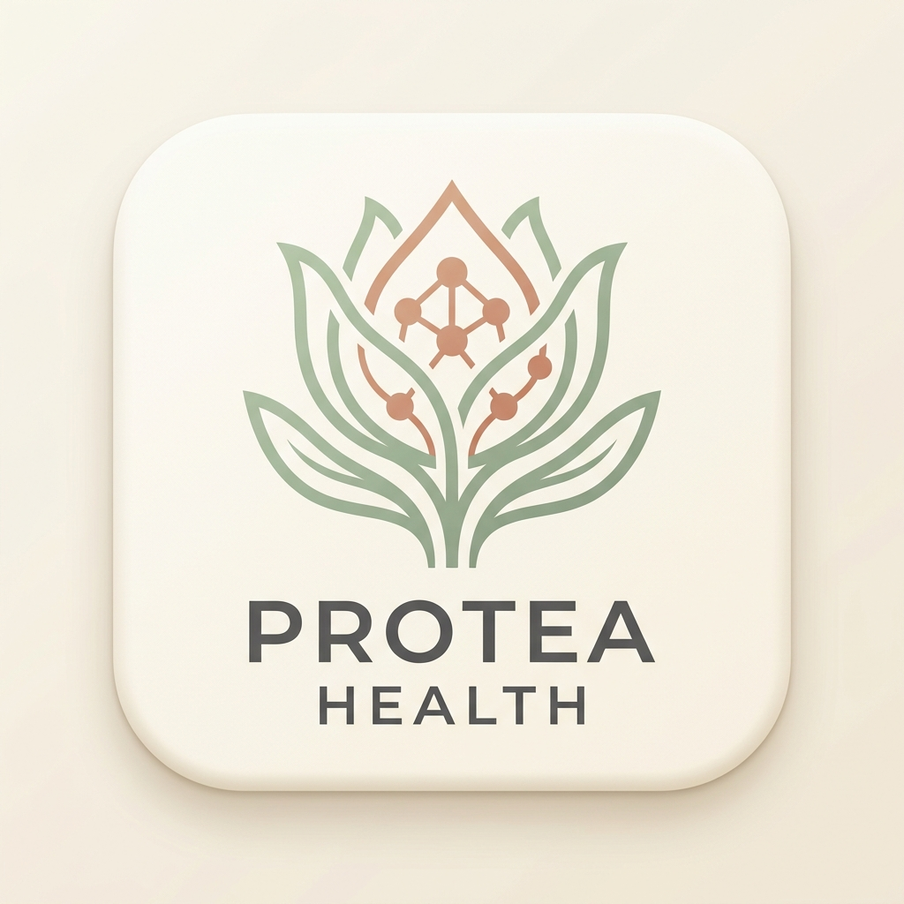
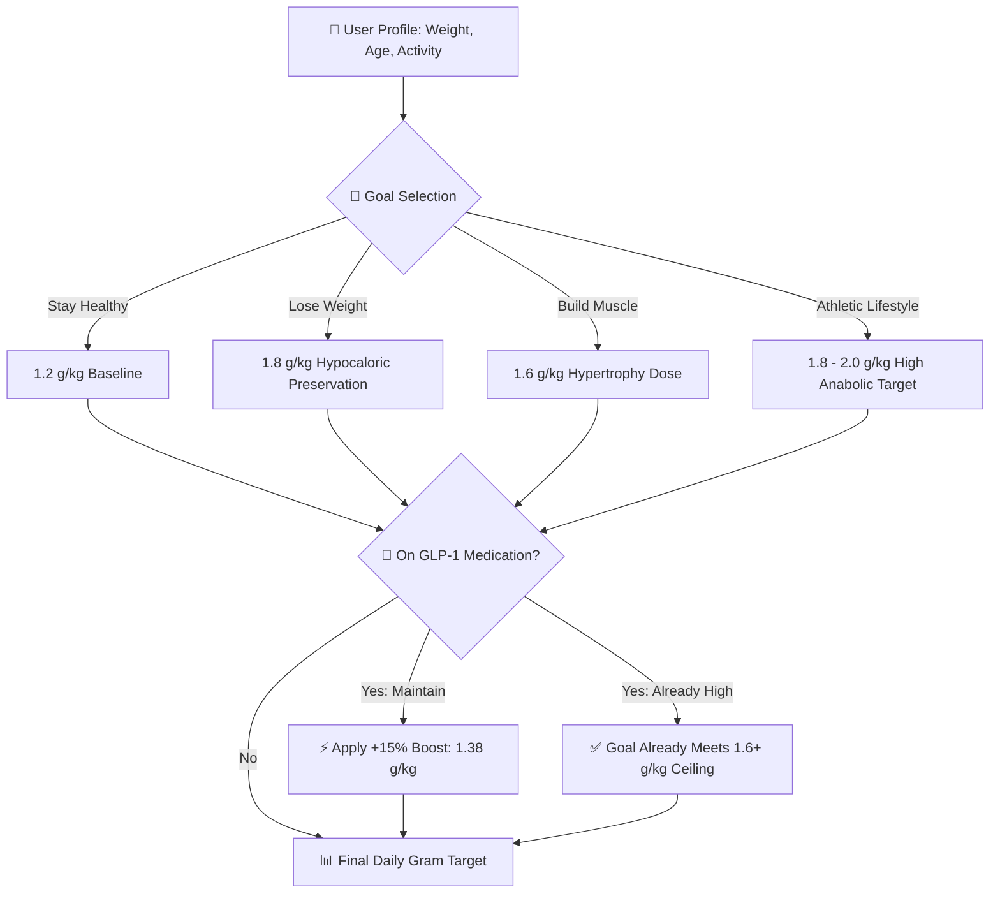

# 🥗 Protea Health — Clinical Protein Tracker & GLP-1 Nutrition Engine

<p align="center">
  
  
</p>
<p align="center">
  <em>Left: Official Production Brand Mark &bull; Right: Architectural Health & Nutrition Emblem</em>
</p>

<p align="center">
  <strong>Scientifically Grounded Daily Protein Calculator, Meal Photo Journal & GLP-1 Lean Mass Preservation System</strong>
</p>

<p align="center">
  <a href="https://play.google.com/store/apps/details?id=com.protea.app">
    
  </a>
  
  
  
  
  
</p>

---

## 🏛️ Engineering Provenance & Production Heritage

> **Production Application Verification:**
> 
> The clinical nutrition calculator, meal snapshot logger, and GLP-1 muscle-preservation engine in this repository are actively deployed in production on the **Google Play Store**:
> - 📱 **Live Production Build:** [`com.protea.app` on Google Play](https://play.google.com/store/apps/details?id=com.protea.app)
> 
> *Notice: This repository presents the full-stack architecture titled **Protea Health** (React Native/Expo Mobile Client + Node.js Cloud Functions backend). All clinical multiplier mathematics, camera-assisted logging flows, In-App Purchase integrations, and Firestore schema architectures were engineered by **Muhammad Ali** as Lead Mobile Engineer.*

---

## 🌟 Executive Overview

**Protea Health** is a modern, evidence-based nutrition application engineered to help individuals achieve optimal protein consumption while preventing lean muscle loss during calorie deficits and GLP-1 (e.g., Ozempic, Wegovy, Mounjaro) therapy.

Unlike generic calorie counters with cluttered UIs, Protea provides:
- **Focused Simplicity:** Effortless meal snapshot logging and instantaneous daily protein tallying.
- **Clinical Rigor:** Target calculations powered by 16+ peer-reviewed studies (PROT-AGE, ESPEN, American College of Sports Medicine).
- **GLP-1 Adaptive Logic:** Automated mathematical adjustments safeguarding muscle mass during rapid weight loss.
- **Premium Organic Aesthetic:** Elegant `#FAF6F1` warm cream visual system crafted for friction-free daily adherence.

---

## 🧬 Scientific Multiplier Matrix & Core Mathematics



### Formula Implementation
$$\text{Target (grams)} = \text{round}\left(\text{Weight in kg} \times \text{Multiplier}\right)$$
$$\text{Weight in kg} = \text{Weight in lbs} \times 0.453592$$

### Clinical Multipliers
| Goal | Baseline Multiplier | 50+ Age Multiplier | Scientific Basis |
|---|---|---|---|
| **Stay healthy** | **1.2 g/kg** | **1.2 g/kg** | Sits above RDA baseline; consensus of US Guidelines & PROT-AGE/ESPEN |
| **Lose weight** | **1.8 g/kg** | **1.8 g/kg** | Preserves nitrogen balance and skeletal muscle in hypocaloric deficit |
| **Build muscle** | **1.6 g/kg** | **1.6 g/kg** | Optimal plateau for muscle protein synthesis (MPS) with resistance training |
| **Athletic** | **1.8 g/kg** | **2.0 g/kg** | Elevated for masters athletes to counteract age-related anabolic resistance |

---

## 🎯 Key Architectural Features

### 1. 📸 Visual Meal Logging & Quick Quantifier
- High-speed camera intake (`expo-image-picker`) with instant photo compression.
- Visual meal timeline allowing users to verify their daily protein distribution across breakfast, lunch, dinner, and snacks.

### 2. 📅 Interactive Timeline Views
- **Day View:** Radial circular progress tracking daily target completion.
- **Week View:** 7-day adherence breakdown with rolling averages.
- **Month View:** Monthly compliance calendar tracking consistency trends.

### 3. 📚 In-App Clinical Research Hub
- Dedicated peer-reviewed research browser linking users directly to the PubMed clinical trials backing their individualized recommendations.

### 4. 💳 Apple StoreKit & Google Play Billing
- Integrated In-App Purchase service supporting premium subscriptions and annual access passes.

---

## 📂 System Monorepo Structure

```
Protea-Health/
├── app/                        # React Native / Expo Mobile Application
│   ├── src/
│   │   ├── app/                # Expo Router root layouts & type-safe navigation
│   │   ├── components/         # BrandLogo, Card, Ring (progress), PrimaryButton
│   │   ├── screens/            # CalculatorView, SourcesView, WeekView, MonthView
│   │   ├── modals/             # GLP1Modal, CitationsModal, EditMealModal, PaywallModal
│   │   ├── me/                 # ResearchContent, SubscriptionContent, PrivacyContent
│   │   ├── lib/                # Colors, constants, helpers, Firebase client
│   │   └── services/           # IAPService, NotificationService, TokenService
│   ├── android/                # Native Android project (Edge-to-edge enabled)
│   ├── ios/                    # Native iOS project (CocoaPods & Swift AppDelegate)
│   ├── app.json                # Expo application configuration & plugin manifests
│   └── package.json            # Client dependencies & scripts
│
├── functions/                  # Firebase Cloud Functions (Node.js/TypeScript)
│   ├── src/
│   │   ├── database/           # Firestore index automation & data migrations
│   │   ├── middleware/         # API rate-limiting & authorization checks
│   │   ├── services/           # Image compression & cloud cache services
│   │   └── index.ts            # Function exports & triggers
│   ├── package.json            # Backend dependencies
│   └── tsconfig.json           # TypeScript compilation config
│
├── assets/                     # Brand assets & logos
└── LICENSE                     # MIT Open Source License
```

---

## 🛠️ Technology Stack

| Domain | Technologies |
|---|---|
| **Mobile Client** | React Native 0.74+, Expo SDK 51+, TypeScript 5.x |
| **Routing & Navigation**| Expo Router (Typed routes & deep linking) |
| **Backend & Cloud** | Firebase Cloud Firestore, Firebase Auth, Cloud Storage, Firebase Functions |
| **Monetization** | In-App Purchases (StoreKit 2 & Google Play Billing) |
| **Device Capabilities** | Native Camera, Photo Library, Haptic Feedback, Local Push Notifications |

---

## 🚀 Getting Started

### Prerequisites
- Node.js (v18.x or v20.x)
- Expo CLI (`npx expo`)
- iOS Simulator (macOS / Xcode) or Android Emulator

### Installation & Run

1. **Clone the repository:**
   ```bash
   git clone https://github.com/itismemuhammadali/Protea-Health.git
   cd Protea-Health/app
   ```

2. **Install dependencies:**
   ```bash
   npm install
   ```

3. **Start the development server:**
   ```bash
   npx expo start
   ```

---

## 👨‍💻 Author & Lead Mobile Engineer

**Muhammad Ali**  
*Full-Stack Mobile Engineer & Solutions Architect*  
- **GitHub:** [@itismemuhammadali](https://github.com/itismemuhammadali)  
- **Email:** [itismemuhammadali@gmail.com](mailto:itismemuhammadali@gmail.com)  

---

## 📄 License
This project is licensed under the [MIT License](LICENSE).
